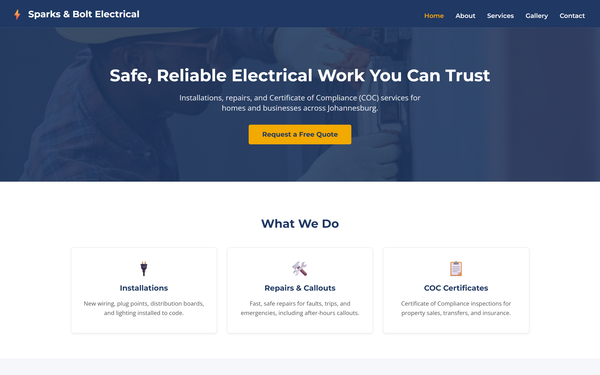
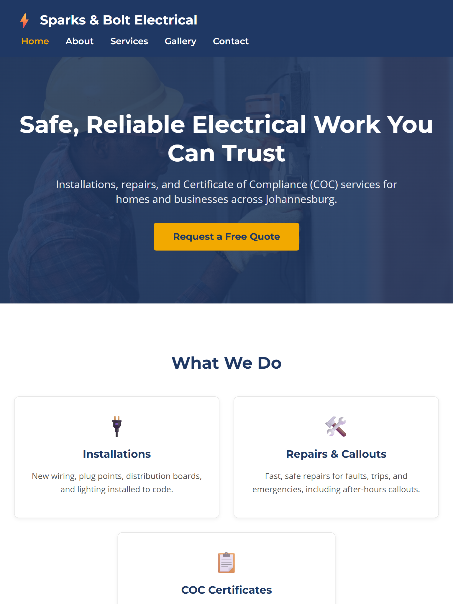
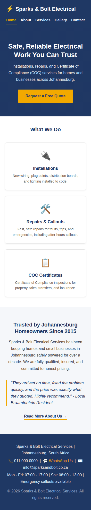

# Sparks & Bolt Electrical Services — Website Project

Web Development POE (WEDE5020)
Student: Roby | Student Number: ST10480499

## Live Site
🔗 https://resplendent-dieffenbachia-164bf0.netlify.app

## About This Project

Website for **Sparks & Bolt Electrical Services**, a hypothetical small electrical contracting business based in Johannesburg, South Africa.

- **Part 1:** HTML structure, inline CSS only, project planning and proposal.
- **Part 2:** External CSS styling for a desktop solution, plus responsive design across desktop, tablet, and mobile breakpoints.
- **Part 3 (current):** JavaScript functionality, form validation, SEO implementation, and external service integration.

## File and Folder Structure

sparks-and-bolt/
- index.html (Homepage)
- robots.txt (SEO instructions for crawlers)
- sitemap.xml (SEO site structure)
- css/
  - style.css (Single external stylesheet)
- js/
  - script.js (All JavaScript functionality)
- pages/
  - about.html
  - services.html
  - gallery.html
  - contact.html
  - enquiry.html (Specific quote request form)
- assets/
  - screenshots/ (Responsive testing screenshots)
- docs/
  - Proposal_1_Sparks_and_Bolt_Electrical.docx
  - Proposal_2_Braamfontein_Bake_House.docx
- README.md

## 1. Working Through Feedback from Part 2

Following the feedback from Part 2, the following actionable items were addressed in this final Part 3 submission:

- **Commit messages:** More descriptive and granular commit messages are being used throughout the Part 3 development phase.
- **README detail:** This document has been substantially expanded to include Part 3 features and updated references.
- **Changelog detail:** The changelog now specifically outlines the additions of JavaScript, SEO files, and new forms.
- **References:** Additional references have been added to cover the JavaScript and SEO techniques used.
- **Content depth & Structure:** Repository structure has been verified. Added `js/` and required SEO files (`robots.txt`, `sitemap.xml`) at the root level to ensure compliance.

## 2. Part 3: JavaScript Enhancements & Functionality

All JavaScript is contained in a single external file (`js/script.js`) and is linked from the bottom of every page to ensure the DOM loads before scripts execute.

### 2.1 Interactive Elements
- **Lightbox Gallery:** The `gallery.html` page now features a functional lightbox. Clicking any gallery image opens it in a larger modal overlay with a close button.
- **Accordion Menu:** The `services.html` page uses an interactive accordion. Service headers act as buttons that expand and collapse the description panels when clicked.
- **Animations/Transitions:** CSS transitions are applied to the accordion panels and the hover states of buttons/links to provide smooth visual feedback.

### 2.2 Dynamic Content & DOM Manipulation
- **Search Filter:** The `services.html` page includes a search input. JavaScript listens for keyup events and dynamically filters the visible service blocks based on the user's text input.

### 2.3 Form Functionality and Validation
The site features two distinct forms, as per the brief:
1.  **Contact Form (`contact.html`):** A general message form.
2.  **Enquiry Form (`enquiry.html`):** A specific quote request form, allowing users to select service types and property types.

**Validation & Submission:**
- **Client-Side Validation:** JavaScript validates that all required fields are filled, that the email address matches a standard regex pattern, and that the phone number is a valid 10-digit SA format. Error messages are displayed dynamically beneath invalid fields.
- **AJAX Simulation:** Upon successful validation, the form data is not sent via a traditional page reload. Instead, an asynchronous simulation (using `setTimeout`) is triggered. The submit button disables, displays a "Processing..." state, and then displays a success modal.
- **Dynamic Response:** The `enquiry.html` form features dynamic response text inside the success modal. If a user requests a "COC", the modal provides an estimated turnaround time specific to COCs.

## 3. Search Engine Optimization (SEO)

The following SEO best practices were implemented:

- **Robots.txt:** Created at the root level to instruct search engine crawlers to index the site and locate the sitemap.
- **Sitemap.xml:** Created at the root level to provide a structured map of all pages to search engines.
- **On-Page SEO:**
  - **Title Tags & Meta Descriptions:** Every page features a unique, keyword-rich `<title>` and `<meta name="description">`.
  - **Header Tags:** Strict use of `<h1>` for page titles and `<h2>` / `<h3>` for sub-sections to establish content hierarchy.
  - **Image Optimization:** All images include descriptive `alt` attributes to aid accessibility and image search.
  - **URL Structure:** Clean, descriptive relative URLs.
  - **Internal Linking:** Consistent navigation bar and contextual links link pages together.
  - **Mobile-Friendliness:** The site retains its responsive breakpoints from Part 2 ensuring Google's mobile-first indexing is satisfied.

## 4. Responsive Testing (Part 2)

The website was tested using real browser rendering at three breakpoints, matching the site's own CSS breakpoints: 1440px (desktop), 768px (tablet, iPad-width), and 375px (mobile, standard phone width).

#### Desktop (1440px)

#### Tablet (768px)

#### Mobile (375px)

At each width, the service cards, navigation, and overall layout were confirmed to reflow correctly according to the breakpoints defined in css/style.css.

## 5. Deployment

The site has been deployed to Netlify and is linked to the GitHub repository. Any updates pushed to the `main` branch automatically trigger a new deployment.

**Live URL:** [https://resplendent-dieffenbachia-164bf0.netlify.app](https://resplendent-dieffenbachia-164bf0.netlify.app)

## Changelog

### v3.0.0 — 30 October 2026
- Added `js/script.js` with comprehensive DOM manipulation and form validation.
- Implemented Lightbox modal functionality for `gallery.html`.
- Implemented Search Filter and Accordion functionality for `services.html`.
- Created `pages/enquiry.html` for specific service quotes.
- Implemented AJAX form submission simulation and dynamic success modals for both `contact.html` and `enquiry.html`.
- Added client-side validation for name, email, phone, service selection, and message length.
- Created `robots.txt` and `sitemap.xml` for SEO.
- Verified all pages have unique Title Tags, Meta Descriptions, and image Alt attributes.
- Updated README.md with Part 3 details and new references.

### v2.0.0 — 17 September 2026
- Extracted all inline CSS from Part 1 into a single external stylesheet (css/style.css).
- Implemented a consistent base style and typography scale using rem units.
- Rebuilt page layouts using CSS Grid and Flexbox.
- Added :hover and :focus states to links, buttons, and form fields.
- Added two responsive breakpoints (900px tablet, 600px mobile).
- Converted all sizing to relative units (rem, em, %).
- Added srcset/sizes to all gallery images.
- Addressed Part 1 feedback.

### v1.0.0 — 9 August 2026
- Initial project setup and folder structure created.
- Built all HTML pages (index, about, services, gallery, contact).
- Added consistent navigation and footer across all pages.

## References

- Unsplash (2026) Free stock photos. Available at: https://unsplash.com (Accessed: 9 August 2026).
- Google Fonts (2026) Montserrat and Open Sans. Available at: https://fonts.google.com (Accessed: 9 August 2026).
- Mozilla Developer Network (2026) JavaScript Form Validation. Available at: https://developer.mozilla.org/en-US/docs/Learn/Forms/Form_validation (Accessed: 30 October 2026).
- Mozilla Developer Network (2026) Introduction to the DOM. Available at: https://developer.mozilla.org/en-US/docs/Web/API/Document_Object_Model/Introduction (Accessed: 30 October 2026).
- Google Search Central (2026) Robots.txt Specifications. Available at: https://developers.google.com/search/docs/crawling-indexing/robots/intro (Accessed: 30 October 2026).
- Mozilla Developer Network (2026) CSS Grid Layout. Available at: https://developer.mozilla.org/en-US/docs/Web/CSS/CSS_grid_layout (Accessed: 17 September 2026).
- Department of Employment and Labour (2026) Electrical Installation Regulations and Certificate of Compliance requirements. Available at: https://www.labour.gov.za (Accessed: 9 August 2026).